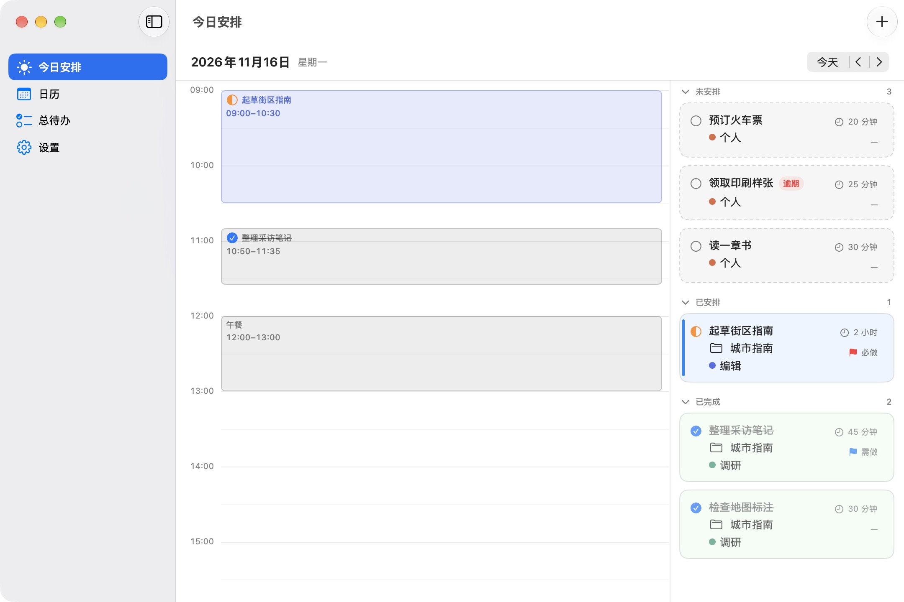
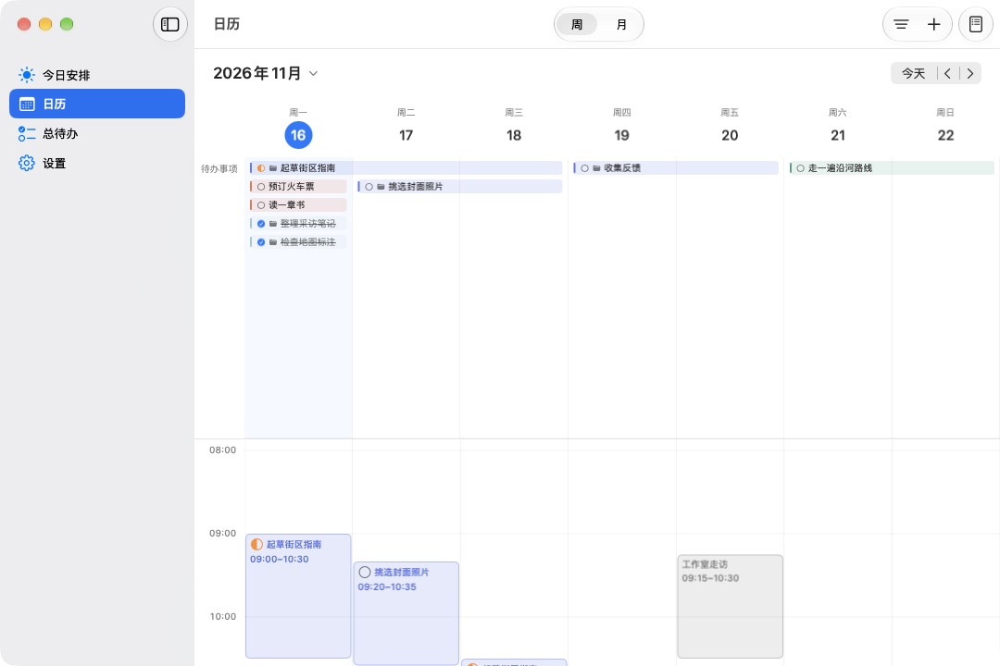
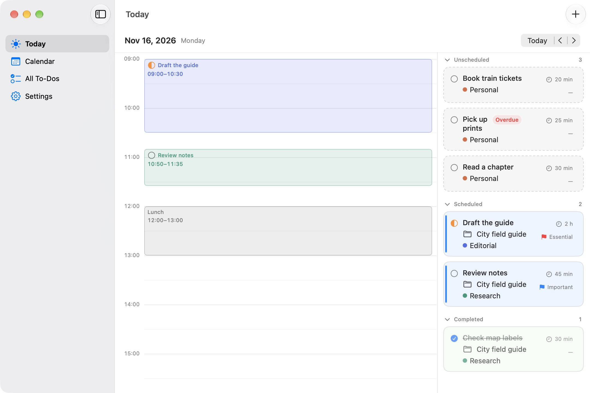
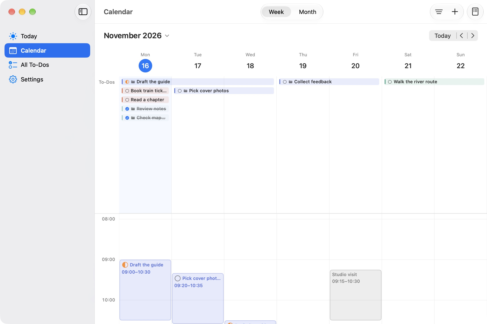

<p align="center"></p>
<h1 align="center">DayVDO</h1>

<details name="readme-language" lang="zh-Hans">
<summary>简体中文</summary>

[Switch to English](#plan-your-day-with-dayvdo)

## 用 DayVDO 规划一天

DayVDO 是一款原生 macOS 应用，把待办清单、每日时间线和日历放在一起。先记下要做的事，再把它拖进时间线留出一段时间，最后在周历或月历中查看前后的安排。

[更新日志](CHANGELOG.md#简体中文)



### 从待办到安排

- **今日安排。** 把右侧的待办拖到时间线上安排时间。拖动安排块可以改时间，拖动上下边缘可以调整时长。也可以在空白时段拖出独立安排。
- **日历。** 月视图适合查看跨天待办和截止日期，周视图把待办与具体的时间安排放在同一页。可以直接拖动待办条来调整日期。
- **总待办。** 用项目归拢相关待办，用彩色标签跨项目分类。待办可以设置开始与截止日期、预计时长、重要度、紧急度和状态。总待办支持搜索，总待办和日历都支持按项目、标签、日期和状态等条件筛选。



### 上手与设置

在 **设置 → 帮助** 的 **新手指引** 中点击 **开始练习**，可以用独立的示例数据练习新建待办、安排时间和标记完成。应用提供简体中文、繁体中文、英语、日语、韩语、西班牙语、法语和德语界面，支持浅色和深色外观、自定义主题色与快捷键，也可以单独关闭各项动画。

### 从源码运行

DayVDO 仍在开发中，目前可从源码运行。构建需要带 macOS 27 SDK 的完整 Xcode 27，Swift 工程没有第三方依赖。最低运行版本设为 macOS 15，当前版本的开发和实机验证使用 macOS 27。

```sh
git clone https://github.com/AlIenwww/DayVDO.git
cd DayVDO
export DEVELOPER_DIR=/Applications/Xcode.app/Contents/Developer
xcrun swift run DayVDO
```

如果 Xcode 装在其他位置，请调整 `DEVELOPER_DIR`。也可以用 Xcode 打开 `Package.swift`，选择 **DayVDO** 后运行。

如需带图标的本地测试版，可以用 Python 3 打包。运行后生成 `dist/local-release/DayVDO macOS27 Release.app`，使用独立的数据目录。打包脚本需要一个没有同名应用的输出目录。

```sh
python3 Scripts/build_app.py --configuration release --output-dir dist/local-release
```

开发时可以运行 `xcrun swift test`。测试包含原生窗口交互，运行时可能会弹出测试窗口。

### 本地数据

常规运行时，待办、项目、标签、安排及其设置保存在本机的 `~/Library/Application Support/DayVDO/todos.json`。同目录下的 `Backups/` 存放应用自动保留的历史快照。

</details>

<details name="readme-language" lang="en" open>
<summary>English</summary>

## Plan your day with DayVDO

DayVDO is a native macOS app that brings a to-do list, a daily timeline, and a calendar together. Capture what you need to do, drag it onto your timeline to set aside time, and see where it fits in your week or month.

[Changelog](CHANGELOG.md#english)



### From to-do to time block

- **Today.** Drag a to-do from the list onto the timeline. Move its block to reschedule it, or drag the top or bottom edge to change its duration. Drag across an empty time slot to create a standalone block.
- **Calendar.** Use the month view to see multi-day to-dos and due dates. The week view shows to-dos and timed blocks together. Drag a to-do bar to change its dates.
- **All To-Dos.** Group related to-dos into projects and use color-coded tags across projects. Add start and due dates, an estimated duration, importance, urgency, and status. Search your list or use filters such as project, tag, date, and status in All To-Dos and Calendar.



### Getting started

In **Settings → Help**, choose **Start practice** under **Getting started** to practice creating, scheduling, and completing a to-do with separate sample data. DayVDO has light and dark appearances, a customizable accent color, editable keyboard shortcuts, and individual animation controls. The app is available in English, Simplified Chinese, Traditional Chinese, Japanese, Korean, Spanish, French, and German.

### Run from source

DayVDO is in development and can be run from source. Building requires the full Xcode 27 installation with the macOS 27 SDK. The Swift package has no third-party dependencies. The deployment target is macOS 15. The current version is developed and tested on macOS 27.

```sh
git clone https://github.com/AlIenwww/DayVDO.git
cd DayVDO
export DEVELOPER_DIR=/Applications/Xcode.app/Contents/Developer
xcrun swift run DayVDO
```

Adjust `DEVELOPER_DIR` if Xcode is installed elsewhere. You can also open `Package.swift` in Xcode and run the **DayVDO** scheme.

To package a local test build with the app icon, run the following with Python 3. It creates `dist/local-release/DayVDO macOS27 Release.app` and uses a separate data directory. Choose an output directory that does not already contain a build with that name.

```sh
python3 Scripts/build_app.py --configuration release --output-dir dist/local-release
```

Run `xcrun swift test` to run the test suite. Some tests may open native windows.

### Local data

A regular run stores to-dos, projects, tags, time blocks, and their settings on your Mac in `~/Library/Application Support/DayVDO/todos.json`. Automatic snapshots are saved in the adjacent `Backups/` folder.

</details>
